# Volta Bipedal Simulation

Walking simulation and whole-body control for the Volta biped, built on [Drake](https://drake.mit.edu/).

<p align="center">
  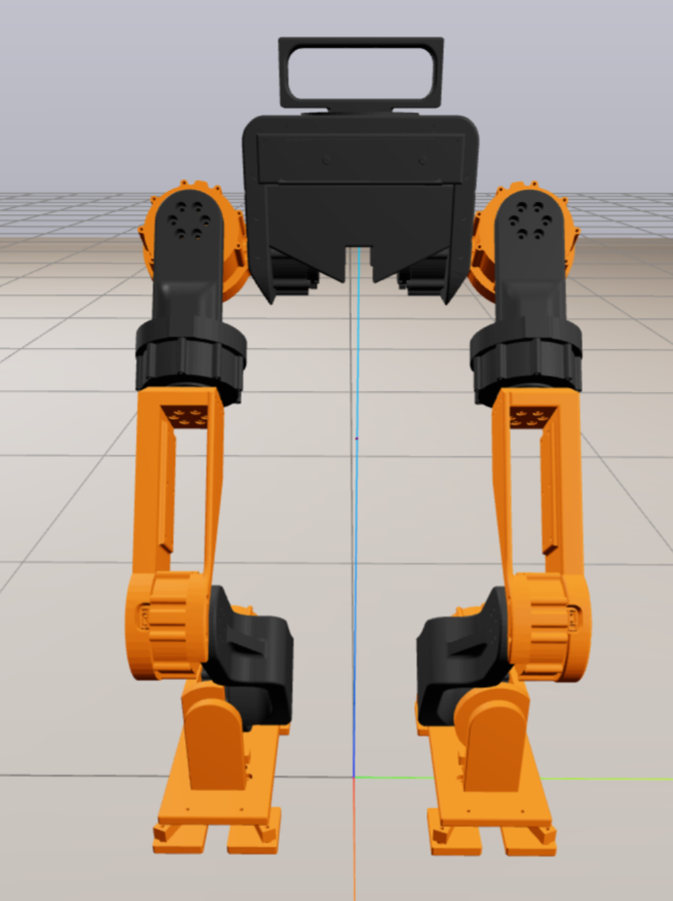
  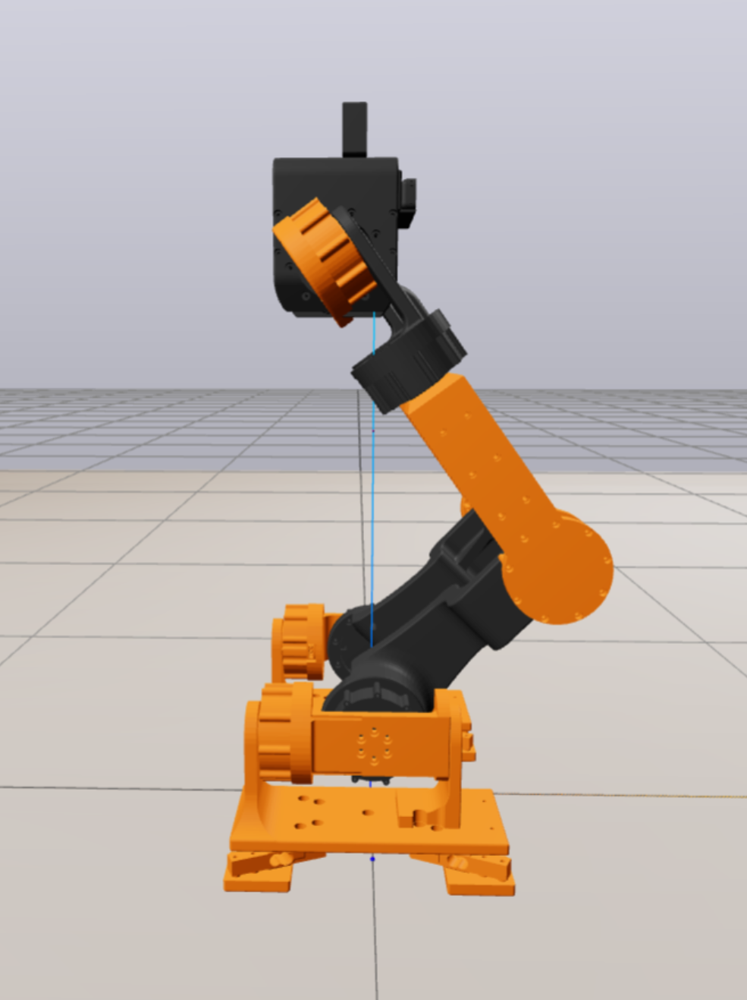
  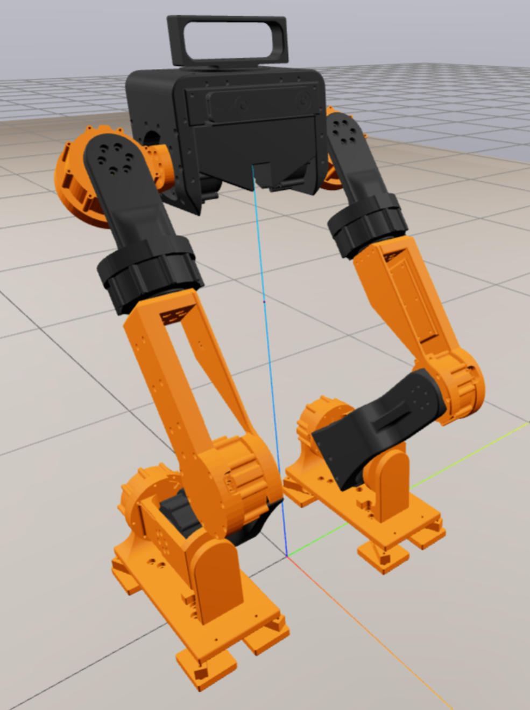
</p>

<table>
  <tr>
    <td align="center" width="33%">
      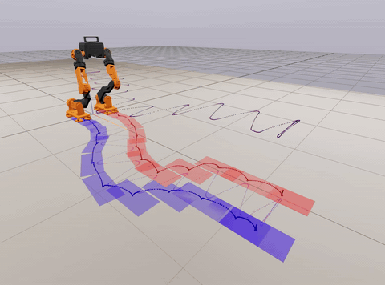<br>
      IS-MPC + WBC omnidirectional walk on a rigid floor (sim, exp <code>1f</code>)
    </td>
    <td align="center" width="33%">
      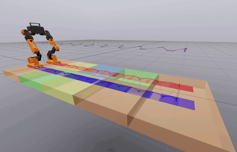<br>
      Walk over tiles of different stiffness and damping (sim, exp <code>4a</code>)
    </td>
    <td align="center" width="33%">
      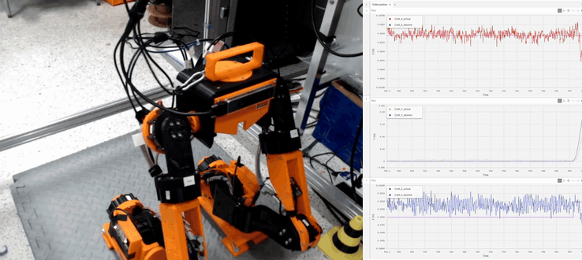<br>
      WBC CoM tracking on the real robot, with the live CoM plot
    </td>
  </tr>
</table>

## Overview

A torque-controlled locomotion framework for the VOLTA humanoid that couples an IS-MPC gait
planner with a passivity-based whole-body controller. The closed loop runs in Drake with
compliant point contact:

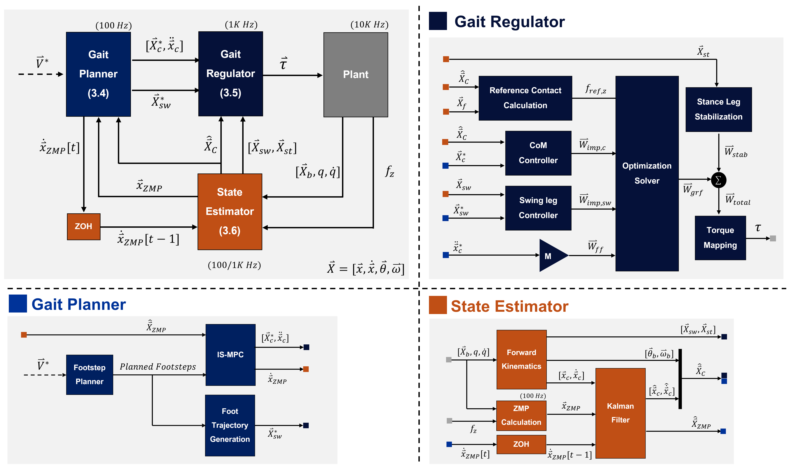

- **Gait planner (100 Hz)**: a footstep planner and an intrinsically stable MPC (IS-MPC) on the
  linear inverted pendulum (LIP). From an omnidirectional velocity command `V* = [vx, vy, ωz]` it
  plans the CoM and ZMP (solved with CasADi + OSQP) and the swing-foot trajectories.
- **Gait regulator (1 kHz)**: a passivity-based WBC. CoM and swing-leg impedance controllers,
  a CoM-based feedforward force and a stance-leg stabilizer feed a QP that distributes the contact
  wrenches between the feet. The wrenches are then mapped to joint torques.
- **State estimator (100 Hz / 1 kHz)**: forward kinematics plus a Kalman filter on the LIP model that
  fuses the measured CoM and the ZMP computed from the foot contact forces.
- **Plant (10 kHz)**: Drake `MultibodyPlant` with a 0.1 ms time step.

## Robot

<table>
  <tr>
    <td align="center">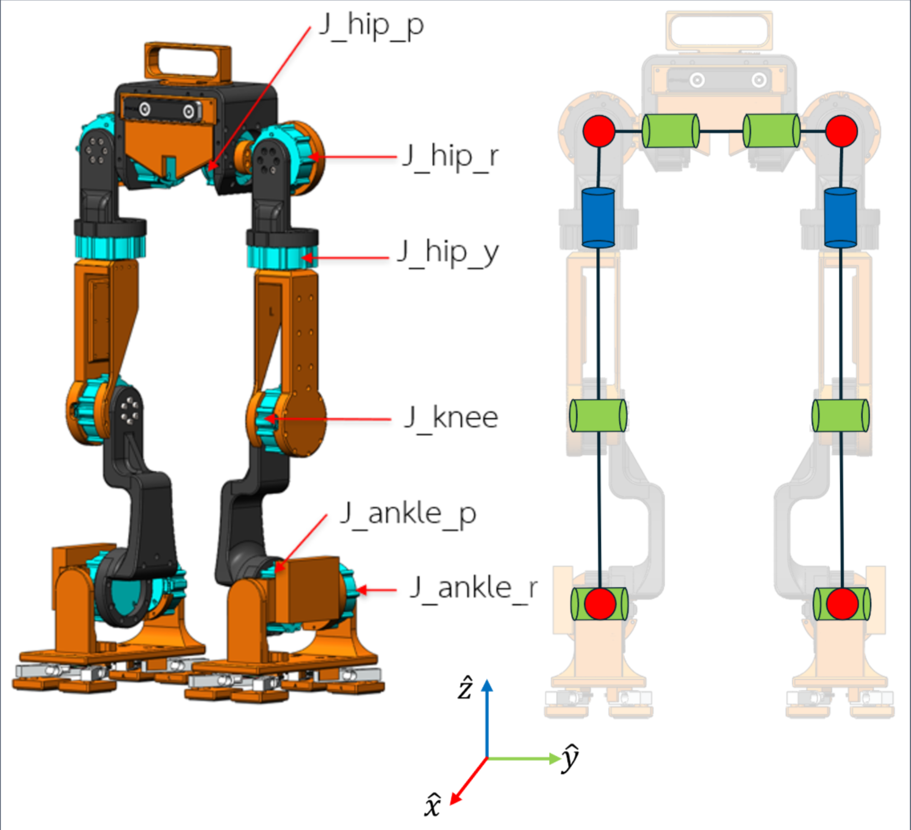<br>Joint configuration</td>
    <td align="center">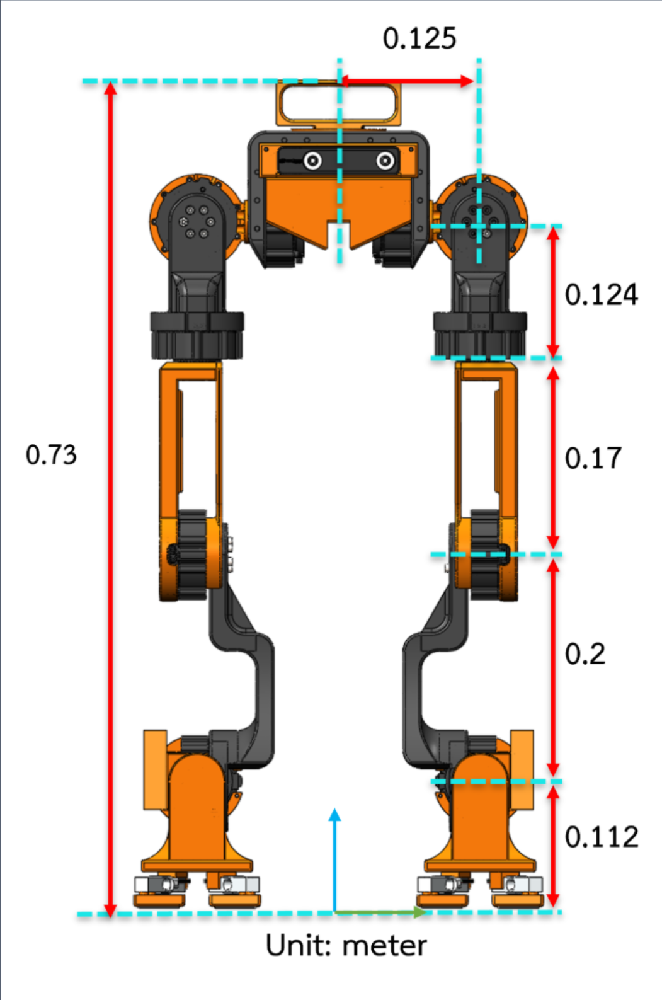<br>Link lengths [m]</td>
  </tr>
</table>

VOLTA is a custom-built biped with 12 torque-controlled joints, 6 per leg, listed from the torso down:

| Joint | Axis |
|---|---|
| `J_hip_p` | hip pitch |
| `J_hip_r` | hip roll |
| `J_hip_y` | hip yaw |
| `J_knee` | knee pitch |
| `J_ankle_p` | ankle pitch |
| `J_ankle_r` | ankle roll |

In the URDF the joints are prefixed `JL_` / `JR_` for the left and right leg.

| Link | Length [m] |
|---|---|
| Torso centre to hip (lateral) | 0.125  |
| Hip roll axis to hip yaw joint | 0.124 |
| Thigh (hip yaw to knee) | 0.17 |
| Shank (knee to ankle) | 0.2 |
| Ankle to sole | 0.112 |

| Property (simulation model, rev5) | Value |
|---|---|
| Total mass | ~7 kg |
| Total height | 0.73 m |
| Degrees of freedom | 6 (floating base) + 12 (joints) |
| Joint torque | 12 Nm limit (`joint_torque_limit` in `ExperimentConfig`), 4 Nm rated |
| Foot contact | 4 contact points per foot (corners of the sole) |
| LIP CoM height | 0.35 m |
| ZMP support box | 0.08 m square (`foot_size`) |

Models in `Models/`: Volta rev5 (used by the experiments).

## Repository layout

```
volta/                  Python package
  Leaf_systems/         Drake LeafSystems (GaitPlanner, StateEstimator, PassivityBasedWBC2, ContactForceSensor, …)
  planning/             IS-MPC, footstep planner, foot trajectory generator, offline planning
  control/              contact wrench solver, stance-leg state machine
  estimation/           Kalman filter
  robot/                kinematics, dynamics, state containers
  experiments/          experiment configs, runner, scene descriptions, velocity profiles
  plotting.py           tracking / CoM-ZMP / footstep plots
  prelude.py            one-line import for notebooks: from volta.prelude import *
Models/                 URDF / xacro, meshes and floor SDFs
Simulation/             notebooks (main: VoltaSimulation_lean.ipynb), see Simulation/README.md
Visualization/          model viewer notebooks and LIP phase portrait
Result/                 figures, videos and papers; logs (Final/Data) and Meshcat
                        recordings (Final/Record) are written here but not tracked in git
```

## Installation

Python 3.12 on Linux (tested with Drake 1.57).

```bash
git clone <repo-url> VoltaBipedalSimulation
cd VoltaBipedalSimulation
python3 -m venv .venv
source .venv/bin/activate
pip install drake numpy scipy matplotlib casadi python-statemachine pydot ipython ipykernel
```

Optional:

- `plotly`, only for `plot_interactive_comparison` in `volta/plotting.py`
- `xacrodoc`, only for regenerating URDFs with `Models/create_urdf.py`

There is no install step for `volta` itself. Run from the repository root (or put it on
`PYTHONPATH`) so `import volta` resolves; all model and result paths are resolved from
`volta/paths.py`, not from the working directory.

## Quick start

**Notebook.** Open `Simulation/VoltaSimulation_lean.ipynb`, set `exp_id` in the
*Simulation parameters* cell and run all cells. The robot is shown in Meshcat at the URL printed
by the first cell.

**Script.**

```python
from volta.experiments.runner import run_experiment

run_experiment("1a", save_graph=True)
```

Useful keyword arguments: `enable_noise` (default `True`), `show_plot`, `fixed_base`,
`set_initial_pose_by` (`"c"` recommended) and `realtime_rate` (default 0.15; `0` runs as fast as
possible).

## Experiments

Defined in `volta/experiments/configs.py` and loaded with `GetConfigByName("<id>")`.
Defaults: floor stiffness 5e6 N/m, dissipation 50 s/m, joint damping 0.3, walking speed 0.1 m/s.

| Id | Name | What changes |
|---|---|---|
| `0a` | stabilization | standing, push of [12, 10, 15] N at 1 s |
| `1a`–`1g` | walking patterns | straight, diagonal, circular, rotate in place, L-shape, combined, forward-backward |
| `2a`–`2d` | soft floor | stiffness 5e3 (`2a`, `2b`) and 2e3 (`2c`, `2d`), combined and L walks |
| `3a`–`3f` | low dissipation | dissipation 30 / 20 / 10 on a soft floor; `3d`–`3f` short straight walks. `3f` uses the same config as `3e`: for this run the stance-leg stabilizer was turned off by hand in `PassivityBasedWBC2.py` (`K=0.0`) |
| `4a`–`4b` | mixed floor | tiled terrain with different stiffness / dissipation per tile; `4b` all stiff |
| `5a`–`5b` | joint damping | damping 0.2 and 0.1 |
| `6a`–`6b` | walking speed | 0.15 and 0.2 m/s |
| `7a`–`7d` | external push | push at 3 s: Fx, Fy, Fx + yaw torque, none (baseline) |

## Results

### Simulation

**How to read the simulation clips**

| Marker | Meaning |
|---|---|
| Red / blue boxes | planned footsteps for the left / right foot (footstep plan) |
| Red / blue dotted arcs | left / right sole trajectory |
| Dark purple dotted line | CoM position |
| Magenta dotted line | CoM projected on the floor |
| Red line (exp `0a`) | external push force applied to the torso |
| Coloured floor tiles (exp `4a`, `4b`) | uneven floor patches (−5 to +8 mm in height); in `4a` each colour also has its own contact stiffness / damping, in `4b` all are stiff |

**CoM stabilization**: Standing on a rigid floor while an external push of [12, 10, 15] N (red line) is applied to the torso at 1 s. The WBC brings the CoM back to its standing position (exp `0a`).

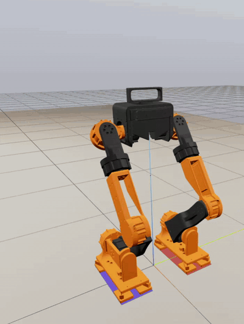

**Combined walk**: Omnidirectional walk combining forward, lateral and turning commands on a rigid floor (exp `1f`).


**Self rotation**: Turning in place (exp `1d`).

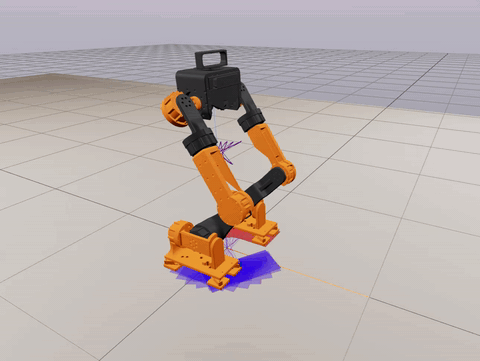

**Walk on compliant floor**: Walking on a soft floor (exp `2`).

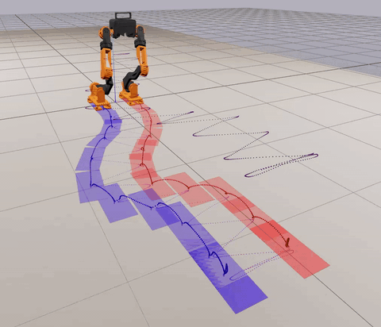

**Mixed-compliance floor**: Straight walk over tiles of different stiffness and damping (exp `4a`).


**Step floor**: Straight walk over stiff tiles at different heights (exp `4b`).

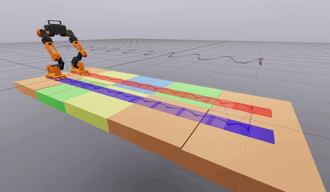

### Hardware

The hardware tests so far run only the whole-body controller (WBC) on the VOLTA prototype, without the gait planner. Each GIF shows the camera view (left) next to the live CoM position plot from the same recording (right): X, Y and Z in metres, actual vs desired, so the plot stays in sync with the robot. The clips play at real speed at 5 fps.

**How to read the hardware plots** (right half of each GIF)

| Line | Meaning |
|---|---|
| Red / green / blue | actual CoM position in X / Y / Z [m] |
| Purple | desired CoM position |

**CoM stabilization**: The robot is told to hold its current pose while it is pushed and pulled by hand. It corrects the pose error and returns to the original pose. (Trimmed to 15–42 s of the recording.)

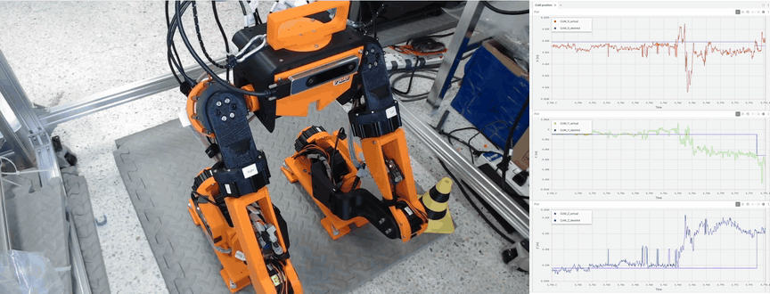

Each push moves the CoM up to about 3.5 cm in X and 4 cm in Y away from the desired position, and the robot brings it back.

**CoM tracking**: The robot is given a target CoM pose and follows a CoM trajectory generated with a cubic polynomial. (Trimmed to 7–35 s of the recording.)


The desired Y follows the cubic trajectory out to +0.08 m and back to -0.08 m. The actual CoM follows the move out closely but stops short on the return.

## Further documentation

- [Paper: A Unified Torque-controlled Locomotion Framework for the VOLTA Humanoid Robot via IS-MPC and Passivity-based WBC](Result/Doc/A%20Unified%20Torque-controlled%20Locomotion%20Framework%20for%20the%20VOLTA%20Humanoid%20Robot%20via%20%20IS-MPC%20and%20Passivity-based%20WBC.pdf)
- [Thesis](Result/Doc/Final_Thesis_Tanawat.pdf)
- [`Simulation/README.md`](Simulation/README.md) covers the notebook parameters, initial-pose modes,
  the closed-loop diagram with port tables, the logged signals and troubleshooting
  (MPC solver failures, Meshcat wiring, slow runs).
